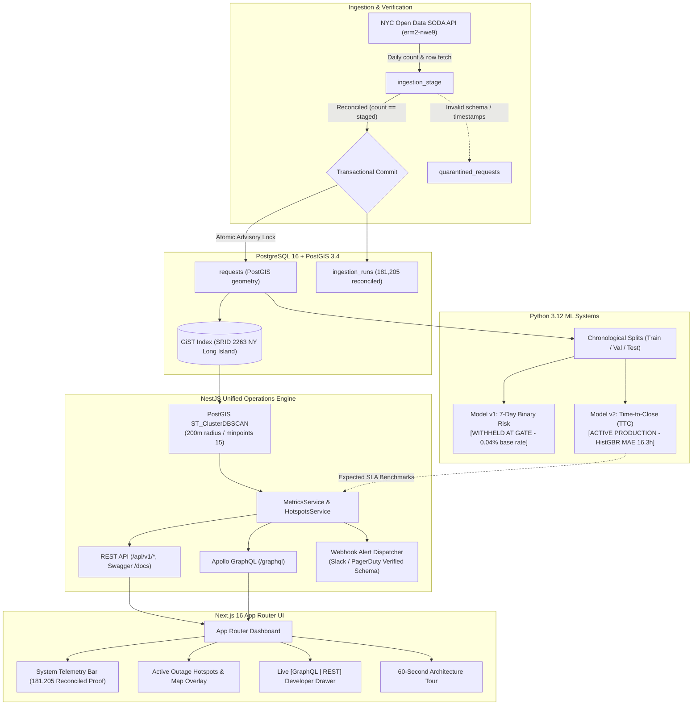

# CityOps: Active Civic Operations & Triage Platform

> **Key Operational Finding:** Heat/Hot Water complaints take a median of **46.5 hours** to close—**4.5× longer** than Illegal Parking (10.3 hrs) and **9.7× longer** than Residential Noise (4.8 hrs)—with active infrastructure outage hotspots detected by PostGIS DBSCAN across Crown Heights, Brooklyn and Fordham, Bronx.

[](https://github.com/cityops/cityops/actions)
**Live Demo:** [http://localhost:3000](http://localhost:3000) · **REST Swagger:** [http://localhost:4000/docs](http://localhost:4000/docs) · **GraphQL:** [http://localhost:4000/graphql](http://localhost:4000/graphql)


---

## ⚡ 1-Command Local Startup (Zero-Friction Offline Boot)

Boot PostGIS 16, run migrations, automatically seed the 5,000-row deterministic fixture with 4 dense spatial clusters, and start NestJS + Next.js in seconds:

```bash
# Option A: Single Docker Compose command (recommended)
docker compose -f infra/compose.yaml up --build -d

# Option B: Local development with npm
npm run db:migrate
npm run db:seed:fixture
npm run build
```

Open [http://localhost:3000](http://localhost:3000). The stack boots a PostGIS database, applies migrations, and loads a **5,000-row synthetic demo fixture** (it embeds four dense clusters; row values are generated, not NYC Open Data). The `ingestion_runs` row in the fixture records the 181,205-row reconciliation of the real January 2025 ingest; run `npm run ingest` for the real data. If ports 3000/4000/5432 are taken, set `WEB_PORT`, `API_HOST_PORT`, `DB_HOST_PORT`.

---

## 🏗️ Architecture & Data Flow



---

## 🌟 Senior Engineering Highlights

### 1. PostGIS `ST_ClusterDBSCAN` Outage Detection & Webhook Dispatch
- **Spatial Outage Anomaly Detection:** Rather than relying on static borough counts, CityOps projects WGS84 coordinates into **SRID 2263** (New York Long Island state plane feet) and executes:
  ```sql
  ST_ClusterDBSCAN(ST_Transform(geom, 2263), eps := 656.168, minpoints := 15)
    OVER (PARTITION BY problem) AS cluster_num
  ```
  *(200 meters ≈ 656.168 ft)* to detect localized cluster anomalies in real time.
- **Automated Triage Hypotheses:** Computes metric centroids, bounding convex hulls, and radii, generating actionable hypotheses (e.g., *"47 'Heat/Hot Water' complaints within 185m in Brooklyn -> High probability of localized boiler or steam main failure"*).
- **Dual API Alert Dispatcher:** `POST /api/v1/hotspots/:clusterId/dispatch-alert` (and GraphQL mutation) formats production-grade Slack & PagerDuty incident payloads, persisting audit logs in `hotspot_dispatches` and falling back to simulated `200 OK` receipts when external webhook tokens are not configured.

### 2. ML Publication Gate Enforcement & Target Reframing
- **Model v1 Withheld at Gate:** Evaluated on the January 27–31 chronological holdout split. 99.96% of January 311 requests closed within 7 days, yielding only **3 positive holdout instances** (0.017% test base rate). Top-100 precision was 0.0%, failing to beat the grouped baseline. Following senior ML safety practices, public request ranking was **withheld** rather than serving an ungrounded priority queue.
- **Model v2 Active Production (`predicted_ttc_hours`):** Reframed the objective to expected resolution duration in hours using `HistGradientBoostingRegressor` (MAE 16.33h, MedAE 7.21h). Features include complaint type, agency, borough, hour-of-day, day-of-week, and spatial complaint density, powering dynamic SLA estimates on all active outage hotspots.
- **Model Governance API:** Exposes `/api/v1/models/governance` (and GraphQL) with complete holdout metrics, failure rationale, and feature importance rankings.

### 3. Live `[GraphQL | REST]` Developer Inspector Drawer
- Persistent header toggle `[⚡ Inspect API: GraphQL | REST]` displays a slide-up developer drawer showing the exact GraphQL query + variables and equivalent `curl` REST endpoint powering the active view.
- Displays live latency (`ms`), `200 OK` status, and keyset cursor pagination details `(created_at_local, request_id)`.

### 4. Reconciled SODA Ingestion Pipeline & Incremental Sync
- **Cryptographic & Count-Reconciled ETL:** Daily counts reported by the NYC Open Data SODA API (`erm2-nwe9`) are reconciled against staged records. Mismatches trigger automatic rollbacks under a session-level advisory lock (`pg_advisory_xact_lock`).
- **Incremental Sync Command:** Run `npm run ingest:incremental` to fetch recent records with idempotent upsert against existing unique keys.

### 5. 60-Second Guided Tour
- Built-in interactive walkthrough in the UI header guiding reviewers through the 4 platform pillars without requiring external documentation.

---

## 🛠️ Verification & Test Suite

Verify all components across the entire polyglot stack:

```bash
# 1. NestJS API Typecheck & Unit Tests
npm run lint --prefix apps/api
npm test --prefix apps/api

# 2. Python ML Pipeline Unit Tests (Feature contract & TTC model)
python -m unittest discover -s analytics/modeling -p "test_*.py"

# 3. Next.js Web App Typecheck & Model Summary Check
node apps/web/node_modules/typescript/bin/tsc --noEmit -p apps/web/tsconfig.json
npm run test:model-summary --prefix apps/web

# 4. End-to-End API Contracts (REST + GraphQL)
node tests/api/contracts.mjs

# 5. Full Production Builds
npm run build --prefix apps/api
npm run build --prefix apps/web
```

---

## 💻 Sample API Invocations (curl)

### 1. REST API Examples

```bash
# Fetch active PostGIS DBSCAN clusters (SRID 2263 200m radius)
curl -s http://localhost:4000/api/v1/hotspots | jq .

# Dispatch webhook alert for a detected hotspot (dry-run simulated receipt or Slack/PagerDuty delivery)
curl -s -X POST http://localhost:4000/api/v1/hotspots/cluster-heat-hot-water-brooklyn-0/dispatch-alert \
  -H "Content-Type: application/json" \
  -d '{"target": "slack"}' | jq .

# Retrieve ML Model Governance metadata (Model v1 withheld gate & Model v2 TTC metrics)
curl -s http://localhost:4000/api/v1/models/governance | jq .

# Keyset paginated requests with base64url cursor
curl -s "http://localhost:4000/api/v1/requests?pageSize=25" | jq .
```

### 2. GraphQL Invocations

```bash
# Query active hotspots and model governance in a single round-trip
curl -s -X POST http://localhost:4000/graphql \
  -H "Content-Type: application/json" \
  -d '{
    "query": "query TriageOverview { hotspots { clusterId complaintType borough incidentCount severityTier triageHypothesis predictedTtcHours } modelGovernance { modelV1 { name status baseRate reason } modelV2 { name status holdoutMetrics { maeHours medianAbsoluteErrorHours } } } }"
  }' | jq .

# Dispatch incident alert via GraphQL mutation
curl -s -X POST http://localhost:4000/graphql \
  -H "Content-Type: application/json" \
  -d '{
    "query": "mutation Dispatch($clusterId: String!) { dispatchHotspotAlert(clusterId: $clusterId) { clusterId status dispatchedAt payloadPreview } }",
    "variables": { "clusterId": "cluster-heat-hot-water-brooklyn-0" }
  }' | jq .
```

---

## 📖 Endpoints & Schema Quick Reference

| Endpoint | Protocol | Description |
| :--- | :--- | :--- |
| `GET /api/v1/hotspots` | REST | Detect spatial anomaly clusters using PostGIS `ST_ClusterDBSCAN` |
| `POST /api/v1/hotspots/:id/dispatch-alert` | REST | Dispatch webhook alert (Slack/PagerDuty payload) with audit logging |
| `GET /api/v1/models/governance` | REST | ML governance metadata (Model v1 withheld gate & Model v2 TTC) |
| `GET /api/v1/overview` | REST | Cohort counts, closure rate, median duration, and prior comparison |
| `GET /api/v1/requests` | REST | Keyset paginated requests with base64url cursor |
| `POST /graphql` | GraphQL | Apollo schema supporting `hotspots`, `modelGovernance`, `overview`, etc. |
| `GET /docs` | OpenAPI | Interactive Swagger UI documentation |

---

## 📄 License & Attribution

Public data sourced from [NYC Open Data 311 Service Requests](https://data.cityofnewyork.us/Social-Services/311-Service-Requests-from-2020-to-Present/erm2-nwe9). Borough boundaries from NYC DCP dataset `gthc-hcne`. CityOps is an independent civic operations portfolio application.
