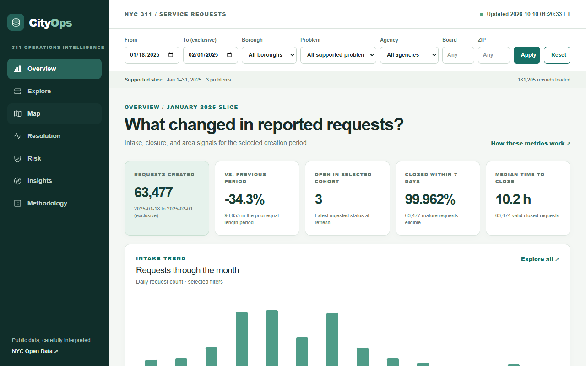

# CityOps

**NYC 311 Operations Intelligence** is an independent, read-only portfolio application for investigating reported problems, closure behavior, and the limits of seven-day risk prediction. It is not an official New York City system.



[Five-minute walkthrough](docs/walkthrough.md) · [Mobile preview](docs/mobile-preview.png)

The first supported release imports **January 1–31, 2025** for **Noise - Residential**, **HEAT/HOT WATER**, and **Illegal Parking**. Those 181,205 source requests were profiled and reconciled on October 10, 2026. The default dashboard compares January 18–31 with the preceding 14 days. It shows the source range and last *actual* successful refresh; it does not claim live data.

## What is implemented

- Next.js App Router dashboard with URL-persisted filters, accessible chart links, request detail, borough map using official NYC DCP boundaries, resolution cohorts, insights, and methodology.
- NestJS API with REST, Swagger at `/docs`, GraphQL at `/graphql`, validated bounded filters, keyset pagination, and capped CSV export. REST and GraphQL use the same metric service.
- PostgreSQL migration, staged NYC SODA ingestion with daily source-count reconciliation, transactional publication, upserts, quality flags, run records, daily aggregates, and an open-status snapshot.
- Python baseline and logistic-regression experiment with a chronological holdout and feature-leakage contract. The public risk ranking is withheld because the held-out test has only three positive outcomes and the model did not beat the grouped baseline.
- Deterministic fixture, API contract checks, browser smoke flow, and GitHub Actions CI.

## Quick start

Use Node **24.15.0** (see `.nvmrc`), npm, Python 3.12 for modeling, and Docker + Compose for the standard local database. Copy `.env.example` to `.env` and keep the latter out of Git. An NYC app token is optional for a short development slice but useful for throttling.

```bash
docker compose -f infra/compose.yaml up -d db
npm ci --prefix apps/api
npm ci --prefix apps/web
cd apps/api
npm run migrate -- up
npm run ingest
npm run start:dev
```

In another terminal:

```bash
cd apps/web
npm run dev
```

Open [CityOps](http://localhost:3000), [REST Swagger](http://localhost:4000/docs), and [GraphQL](http://localhost:4000/graphql). The importer reads `INGEST_START_DATE` and `INGEST_END_DATE` from the environment; defaults are the supported January 2025 range. One invocation accepts no more than 31 days. For a one-day check, set `INGEST_START_DATE=2025-01-18` and `INGEST_END_DATE=2025-01-19`. Repeating the same range updates existing source IDs without duplicating requests.

To run all services in Compose instead:

```bash
docker compose -f infra/compose.yaml up --build -d db api web
docker compose -f infra/compose.yaml --profile ingest run --rm ingest
```

The API container applies migrations on startup for this single-instance local setup. Hosted deployments should apply migrations once in a release step before starting new API replicas. Set `API_INTERNAL_URL` to the container/private API address and `NEXT_PUBLIC_API_URL` to the browser-reachable HTTPS API address in deployment. Restrict `WEB_ORIGIN` to the real web origin. No hosted demo or managed schedule is configured in this repository.

## Reproduce the model experiment

```bash
python -m venv .venv
# Activate .venv with your shell's activation command.
python -m pip install -r analytics/modeling/requirements.txt
python analytics/modeling/train.py
```

`DATABASE_URL` must point to a database containing the January slice and a successful ingestion run. The script writes `analytics/modeling/report.json` and a locally ignored `model.joblib`. It never publishes predictions as a side effect. The [model card](docs/model-card.md) explains the failure of the publication gate.

## Verify

```bash
npm run lint --prefix apps/api
npm run lint --prefix apps/web
npm test --prefix apps/api
python -m unittest discover -s analytics/modeling -p 'test_*.py'
npm run build --prefix apps/api
npm run build --prefix apps/web
```

CI migrates a disposable PostgreSQL service, loads an eight-row deterministic fixture, starts both apps, checks API metric contracts, and runs the Playwright investigation flow. It never calls the live NYC API. The `ingest.yaml` workflow is disabled until `CITYOPS_INGEST_ENABLED=true` and the database secret and date variables are configured.

## Documentation

- [Architecture](docs/architecture.md) and publication behavior
- [Metric dictionary](docs/metric-dictionary.md)
- [Source contract and profiling](docs/source-contract.md)
- [GraphQL contract](docs/graphql.md)
- [Reproducible January findings](docs/findings/january-2025.md)
- [Runnable SQL queries](db/queries) for period change, cohorts, and quality reconciliation
- [Model card](docs/model-card.md) and [evaluation report](analytics/modeling/report.json)

## Known limits

311 counts are reports received, not confirmed incidents. Raw borough counts are affected by population and reporting behavior. Current source status cannot reconstruct past backlog without CityOps snapshots. Floating source timestamps create daylight saving ambiguity. The available source row does not fully reconstruct reopenings or initial agency assignment. The selected January categories yield only 64 unresolved-after-seven-day labels, so a ranked risk queue would overstate what the data supports. Public deployment and an actual refresh schedule still require hosting and credentials.

Data source: [NYC Open Data 311 Service Requests from 2020 to Present](https://data.cityofnewyork.us/Social-Services/311-Service-Requests-from-2020-to-Present/erm2-nwe9). Borough boundaries: [NYC DCP Borough Boundaries](https://data.cityofnewyork.us/City-Government/Borough-Boundaries/gthc-hcne/data).
