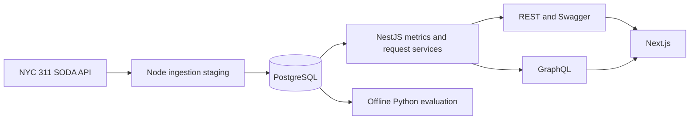

# CityOps architecture

CityOps is an independent, read-only NYC 311 analytics application. The browser calls the Next.js server for rendered pages, and Next.js calls the NestJS API. The browser uses the API only for bounded CSV downloads. Neither the browser nor Next.js connects to PostgreSQL.

## Data publication

The importer fetches bounded daily partitions, stores each source page in `ingestion_stage`, and reconciles the staged unique-key count with the source count for every day. A single database transaction then upserts raw and cleaned records, rebuilds impacted daily aggregates, records the latest open snapshot, and marks the run successful. A failed fetch or reconciliation leaves the previously published request tables and latest successful refresh timestamp intact. Failed runs remain in `ingestion_runs`; invalid source rows are quarantined.

The first supported source slice is January 1 through February 1, 2025 (exclusive), for Noise - Residential, HEAT/HOT WATER, and Illegal Parking. It is a scoped release, not all 311 activity. An importer invocation accepts at most 31 days; a wider backfill should be split into bounded runs.

## API boundary

REST serves health, metadata, quality, filtered request pages and detail, bounded CSV, and analytical reads. GraphQL composes overview, intake trend, problem mix, borough comparison, and resolution views. Both transports call `MetricsService` and the same parameterized SQL. REST is at `/api/v1`, Swagger at `/docs`, and GraphQL at `/graphql`.

Analysis filters have a one-day minimum and 366-day maximum. Date ranges use an inclusive `from` and exclusive `toExclusive`. Request pages use a `(created_at_local DESC, request_id DESC)` keyset cursor. Exports fail above 5,000 rows instead of silently truncating.

The initial bounded month is queried from indexed requests. `daily_intake_metrics` is materialized and reconciled for future broad-period optimization; the shared service can switch to it after filter and count parity checks. The map uses the official DCP borough boundary dataset `gthc-hcne`, simplified for the browser. It never invents polygon locations from ZIP strings.

## Time and history

The source publishes floating civil timestamps. CityOps stores them as NYC-local `timestamp without time zone` and uses that same basis for closure duration and seven-day thresholds. The last successful ingestion's New York local clock supplies the analysis cutoff. Source data cannot recover every prior reopening. Daily snapshots start when CityOps ingests data; it does not manufacture backlog history before then.

## Model boundary

Python trains offline against a versioned SQL extraction. No model is called during page requests. A public ranking requires future-period evidence that improves on a grouped historical-rate baseline and an adequate number of positives. The first January experiment fails that gate; the Risk route explains the result without showing unvalidated scores.
